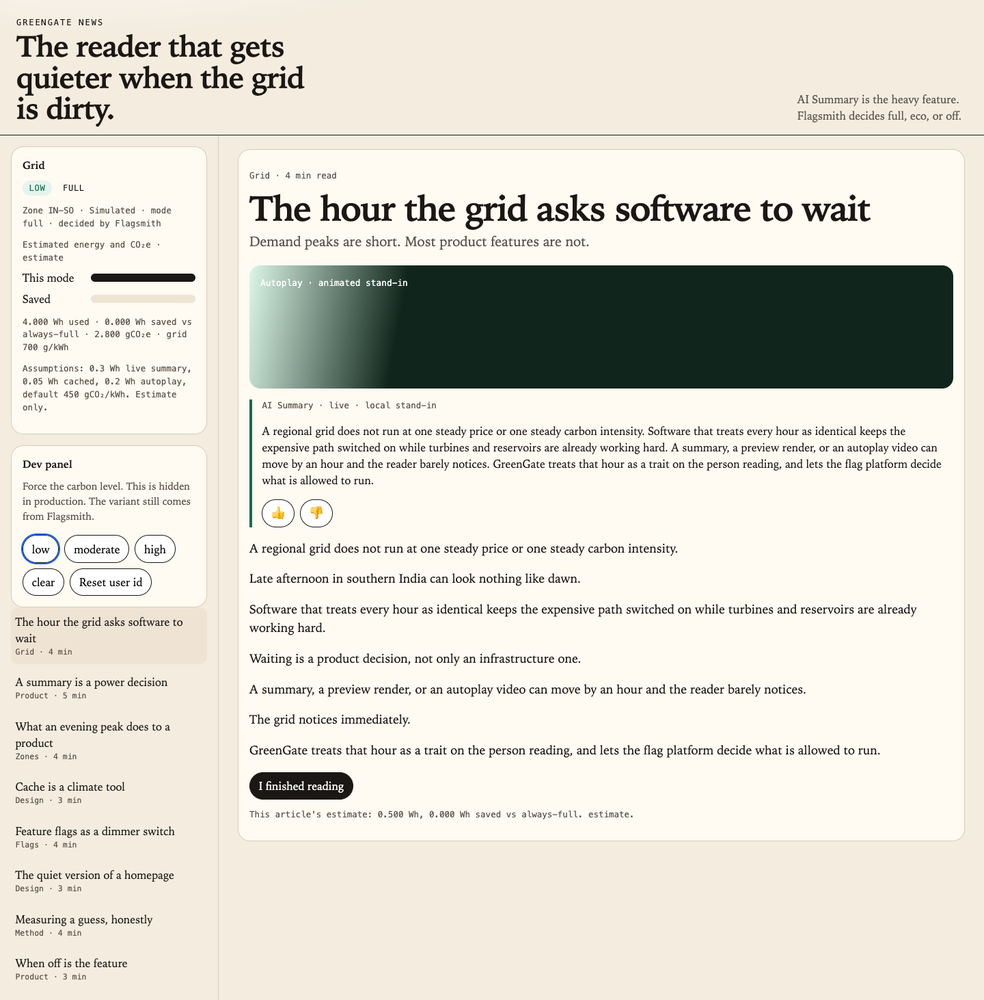
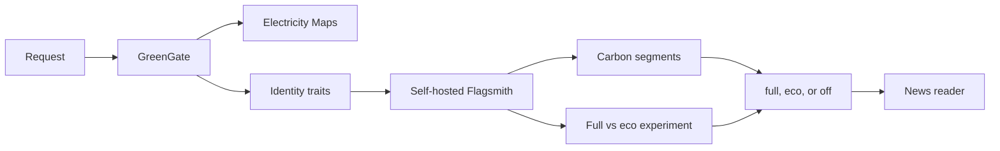

# GreenGate

Carbon-aware feature flags for [Flagsmith](https://www.flagsmith.com/). When the grid is dirty, the heavy feature gets quieter. Flagsmith makes that decision.



## 30 seconds

A request comes in. GreenGate reads the local carbon level, sends it to Flagsmith as an identity trait, and Flagsmith returns `full`, `eco`, or `off`. The [news reader](apps/demo) shows the difference: an animated stand-in and a live summary, a still image and a cached summary, or the sentence "Paused because the grid is dirty right now". The same flag ran a real Flagsmith experiment, full against eco. That traffic is **SIMULATED**.

## Problem and impact

The figures below are the ones printed in Jillian Ambrose, [“Datacentres to create 70% more carbon emissions by 2030, IEA report warns”](https://www.theguardian.com/world/2026/nov/19/datacentres-to-create-70-more-carbon-emissions-by-2030-iea-report-warns), *The Guardian*, 19 November 2026. That article reports International Energy Agency findings. On 23 November 2026 the IEA report page and the IEA news page both stopped at a sign-in wall from this network, so this README does not quote numbers from those two pages.

- Datacentres will create 70% more carbon emissions by 2030.
- They will consume twice as much electricity by 2030. The global expansion of AI accounts for three-quarters of that growth.
- Within four years, AI datacentres will consume an extra 350 terawatt-hours a year, more than Great Britain’s annual electricity consumption.
- By 2030 the United States is expected to rely on gas for about 60% of datacentre electricity. The article also says around half of the electricity for China’s AI datacentres will come from coal.

GreenGate does not claim to shrink a datacentre. It gives an application one flag so the expensive path can step down when the grid serving that user is dirty, and a kill switch that forces `full` if the product must stay on.

## Architecture



Electricity Maps is skipped when no token is set. The demo then uses a simulated carbon level and says so on the page. That label is the grid source. It is separate from the **SIMULATED** label on experiment traffic.

## Quickstart

Three commands. Docker Desktop needs to be running. Flagsmith publishes on port 8100 so it does not touch anything already bound to port 8000.

```bash
docker compose up -d
node scripts/bootstrap-flagsmith.mjs
docker compose up -d --force-recreate demo
```

Then open [http://localhost:3000](http://localhost:3000). The Flagsmith dashboard is [http://localhost:8100](http://localhost:8100). The admin password is written only to the gitignored `.env`.

A new Docker volume creates the admin user during bootstrap. If this machine already has that volume, put the existing `.env` in the clone before the second command. Bootstrap will not invent a second password.

The first `docker compose up` starts the demo before `.env` exists. Compose still parses, because the env file is optional. The third command restarts the demo so it can see the server key bootstrap just wrote. Dev tools on the page can force low, moderate, or high. The variant still comes from Flagsmith.

Checks, from a clone:

```bash
npm ci
npm run typecheck && npm test && npm run build
```

## Use GreenGate in your app

```ts
import { Flagsmith } from '@flagsmith/nodejs';
import { createGreenGate } from '@greengate/flagsmith';

const flagsmith = new Flagsmith({ environmentKey: process.env.FLAGSMITH_ENVIRONMENT_KEY_DEVELOPMENT! });
const gate = createGreenGate({
  flagsmith,
  electricityMapsToken: process.env.ELECTRICITY_MAPS_TOKEN,
  mapping: 'strict',
  mode: 'traits',
});

const decision = await gate.evaluate(userId);
// decision.variant is full, eco, or off
```

`mode: 'traits'` lets Flagsmith segments choose. `mode: 'override'` uses the local mapping and still records the trait. With no Flagsmith client, the plugin returns the local mapping and sets `source` to `local`. API details are in [packages/greengate/README.md](packages/greengate/README.md).

## Experiment

Hypothesis: eco mode does not reduce session completion compared with full. Flag `heavy_feature_mode`, control value `full`, eco at 50%, Development only. Carbon segment overrides were turned off for the run so they could not replace the split, then restored.

The 2,000 readers came from `scripts/simulate-traffic.mjs`. They are **SIMULATED**. Full completed 628/1027 (61.1%). Eco completed 598/973 (61.5%). Difference +0.3 percentage points, 95% CI −4.0% to +4.6%, two-sided p = 0.89. Flagsmith’s warehouse showed a 55% chance eco is best and a +0.4% lift, with a 95% interval from −6.6% to +7.4%. That interval includes no difference. Write-up and screenshot: [docs/experiment-results.md](docs/experiment-results.md).

## Energy model

The meter is an estimate, not a measurement. Assumptions in `apps/demo/src/energy.ts`: 0.3 Wh for a live summary, 0.05 Wh for a cached summary, 0 Wh when the summary is paused, 0.2 Wh for the autoplay stand-in. Default grid intensity is 450 gCO₂/kWh. Named zones are also assumptions (IN-SO 700, DE 380, FR 60, GB 180, US-CAL-CISO 230). The page prints “estimate”.

## Limitations

- No Electricity Maps token is configured in this environment, so the demo’s carbon level is simulated unless you set `ELECTRICITY_MAPS_TOKEN`.
- The experiment interval crosses zero. It does not show that eco changes completion.
- Summaries are a local extractive stand-in unless `LLM_API_KEY` and `LLM_BASE_URL` are both set.
- The plugin targets Node and `@flagsmith/nodejs`. There is no React hook or edge runtime yet.

## Roadmap

- A React hook that calls the same evaluation on the server and hydrates the variant.
- An edge runtime build that does not assume a long-lived Node process.
- More carbon providers, including WattTime.

## How to Win

Criteria from [How to Win Toggle Wars](https://www.wemakedevs.org/blogs/how-to-win-toggle-wars) and the [Toggle Wars scorecard](https://www.wemakedevs.org/hackathons/flagsmith).

| Criterion | Where this repo meets it |
| --- | --- |
| Use of Flagsmith. Delete Flagsmith and the behaviour should change. | Segments choose `full`, `eco`, and `off`. The experiment assigned the variant. `source: flagsmith` is on the API response. |
| Impact. A developer would use it. | `@greengate/flagsmith` is one call. The news reader is the working example. |
| Creativity. A familiar idea taken somewhere new. | Carbon level is an identity trait. The flag is a dimmer, not an on/off banner. |
| Demo video. Problem, the thing working, Flagsmith. Two or three minutes. | [docs/demo-script.md](docs/demo-script.md). Recording the video is a manual step. |
| Track 01. One clear hypothesis. | Eco does not reduce completion versus full. [docs/experiment-results.md](docs/experiment-results.md). |
| Track 01. Both versions behind a flag. | `heavy_feature_mode` is multivariate. Control value `full`, treatment `eco`. |
| Track 01. A metric from real events. | `article_completed`, plus `summary_shown` and `summary_feedback`. The events are real SDK events. The people are **SIMULATED**. |
| Track 01. Results you can explain. The interval crosses zero. | 55% chance, +0.4% lift, interval −6.6% to +7.4%. The write-up says that is not a win. |
| Track 03. Self-hosted Flagsmith. | Official Compose file in `flagsmith/`, dashboard on port 8100. |
| Track 03. A plugin others can reuse. | `packages/greengate`, [its README](packages/greengate/README.md), and this quickstart. |
| Stable identifier. | Cookie `gg_uid` and header `x-gg-uid`. The simulator uses `sim-00001` onward. |
| Exposures on both arms. | Flagsmith: control 1,027 and eco 974. Excluded identities: 0. |
| Conversions use the same identifier, and they fire when the event happens. | `article_completed` is sent on “I finished reading” or a real scroll to the end, with the same id as the exposure. |
| Multivariate from the start. | Bootstrap creates `full`, `eco`, and `off` with keys before any experiment. |
| A guardrail you do not expect to move. | Time to first summary and thumbs-up rate. Both stayed close. |
| README a stranger can run. Keys stay out of git. | This quickstart. `.env` is gitignored. `.env.example` has placeholders only. |

## Credits

GreenGate is by ANEEK DAS. Flagsmith is the flag and experiment engine. Electricity Maps is the optional live carbon source. The problem figures are from the Guardian article linked above. The hackathon is [Toggle Wars](https://www.wemakedevs.org/hackathons/flagsmith) by WeMakeDevs.

Decisions that diverged from a prompt, including the sign-in wall on the IEA pages, are in [docs/decisions.md](docs/decisions.md). Contributing notes are in [CONTRIBUTING.md](CONTRIBUTING.md).
