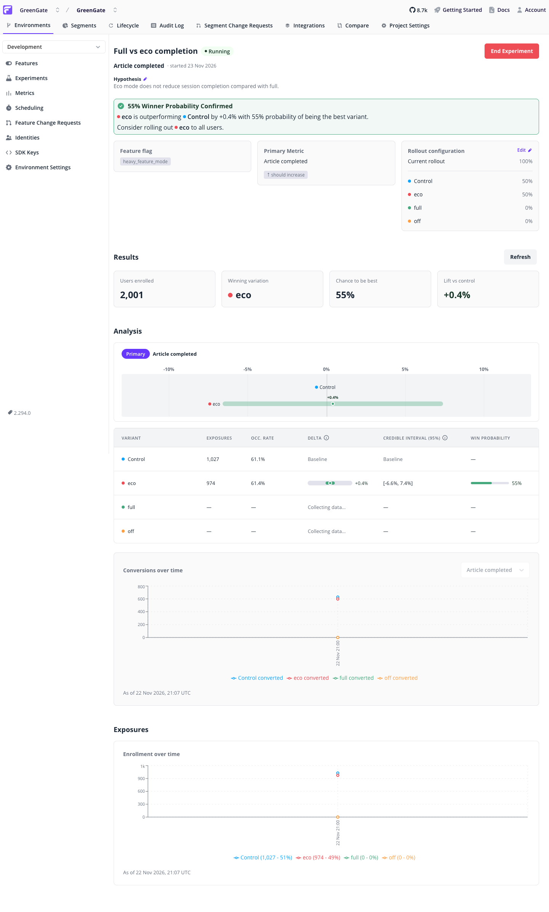

# Experiment results

**SIMULATED.** Every reader in this experiment was generated by `scripts/simulate-traffic.mjs`. These are not live people, and the completion rates were drawn to sit near 62% for full and 60% for eco.

## Setup

- Hypothesis: Eco mode does not reduce session completion compared with full.
- Flag: `heavy_feature_mode` in the Development environment.
- Control value: `full`. Treatment: `eco` at 50%. The `off` variation stays at 0% for this test.
- Rollout: 100% of identities. Flagsmith stores that rollout on a system segment named `experiment-<id>-rollout`.
- Primary metric: occurrence of `article_completed`.
- Secondary metrics: mean of `summary_shown` (milliseconds) and mean of `summary_feedback` (1 = thumbs up, 0 = thumbs down).
- Experiment id: 2. Status when reported: running.

## Override handling

`carbon_moderate` and `carbon_high` would beat the random split, because segment priority is higher than the experiment rollout segment. `scripts/setup-experiment.mjs` deletes both overrides in Development before the experiment starts. Production is not changed. `scripts/restore-carbon-routing.mjs` removes the rollout override, completes the experiment, and puts the two carbon overrides back.

The simulator does not force a grid level. With no Electricity Maps token the demo's own carbon reading is the simulated `moderate` level, which is exactly the override that had to be turned off.

## SIMULATED tally

| Variant | Readers | Completed | Completion | Mean summary ms | Thumbs-up rate |
| --- | ---: | ---: | ---: | ---: | ---: |
| full | 1027 | 628 | 61.1% | 66.5 | 72.9% |
| eco | 973 | 598 | 61.5% | 65.8 | 69.3% |

Sample size is the number of stable ids `sim-00001` through `sim-02000` that the demo actually served.

## Difference, interval, and z-test

Control is full. Treatment is eco. The difference is eco minus full.

- Full completion: 628/1027 (61.1%)
- Eco completion: 598/973 (61.5%)
- Difference: 0.3% (0.0031 absolute)
- 95% CI for the difference: -4.0% to 4.6%
- Two-sided z = 0.14, p = 0.8867

The z-test does not show a completion drop. That matches the hypothesis that eco mode does not reduce session completion.

## Flagsmith verdict

Flagsmith read the same SIMULATED events from its Postgres warehouse.

- Exposures: control 1027, eco 974, excluded 0. The control variant key is `control` and the flag value is `full`.
- Article completed: control 628/1027, eco 598/974. The results page shows a 55% chance that eco is best and a +0.4% lift, and its banner suggests a rollout. The 95% interval is −6.6% to +7.4%, which includes no difference, so this SIMULATED run does not show that eco changes completion.
- Time to first summary: eco is about 1.1% faster, chance to win 77.9%, interval crosses zero.
- Thumbs-up values sum to 395 (control) and 375 (eco). Flagsmith divides by every exposed identity, so that mean is not the rate among people who voted. The table above is the rate among votes.
- The eco exposure count is one higher than the tally because `sim-smoke-01` was a labelled check before the 2000 ids. That identity did not convert.

Results refresh HTTP status: 202.
Exposures refresh HTTP status: 202.
Flagsmith payload (warehouse aggregate, still from SIMULATED events):

```json
{
  "results": {
    "as_of": "2026-11-22T21:07:40.707283Z",
    "last_error_at": null,
    "refresh_requested_at": "2026-11-22T21:07:40.656089Z",
    "payload": {
      "metrics": [
        {
          "variants": {
            "eco": {
              "n": 974,
              "sum": 598,
              "sum_squares": 598
            },
            "control": {
              "n": 1027,
              "sum": 628,
              "sum_squares": 628
            }
          },
          "inference": {
            "eco": {
              "lift": 0.0040446513817864495,
              "ci_low": -0.06595974835263162,
              "ci_high": 0.07404905111620451,
              "chance_to_win": 0.5450802701976294
            }
          },
          "metric_id": 1,
          "conversions_timeseries": {
            "points": [
              {
                "bucket": "2026-11-22T21:00:00+00:00",
                "converted_identities": {
                  "eco": 598,
                  "control": 628
                }
              }
            ],
            "granularity": "hour"
          }
        },
        {
          "variants": {
            "eco": {
              "n": 974,
              "sum": 64036,
              "sum_squares": 4687300
            },
            "control": {
              "n": 1027,
              "sum": 68295,
              "sum_squares": 5038221
            }
          },
          "inference": {
            "eco": {
              "lift": -0.011340432923783046,
              "ci_low": -0.04028231673995317,
              "ci_high": 0.01760145089238707,
              "chance_to_win": 0.7787510019124425
            }
          },
          "metric_id": 2,
          "conversions_timeseries": null
        },
        {
          "variants": {
            "eco": {
              "n": 974,
              "sum": 375,
              "sum_squares": 375
            },
            "control": {
              "n": 1027,
              "sum": 395,
              "sum_squares": 395
            }
          },
          "inference": {
            "eco": {
              "lift": 0.0010266940451745254,
              "ci_low": -0.10997873108788815,
              "ci_high": 0.1120321191782372,
              "chance_to_win": 0.5072315469467226
            }
          },
          "metric_id": 3,
          "conversions_timeseries": null
        }
      ],
      "srm_p_value": null,
      "exposures_timeseries": {
        "points": [
          {
            "bucket": "2026-11-22T21:00:00+00:00",
            "new_identities": {
              "eco": 974,
              "control": 1027
            }
          }
        ],
        "granularity": "hour"
      }
    },
    "is_final": false
  },
  "exposures": {
    "as_of": "2026-11-22T21:07:40.767291Z",
    "last_error_at": null,
    "refresh_requested_at": "2026-11-22T21:07:40.673792Z",
    "payload": {
      "timeseries": {
        "points": [
          {
            "bucket": "2026-11-22T21:00:00+00:00",
            "new_identities": {
              "eco": 974,
              "control": 1027
            }
          }
        ],
        "granularity": "hour"
      },
      "excluded_identities": 0
    },
    "is_final": false
  }
}
```

Flagsmith's own analysis is Bayesian (chance to be best, lift versus control). This self-hosted build shows "Collecting data" until a variation has at least 50 identities and, for an occurrence metric, 5 conversions. A sample-ratio warning compares traffic with the environment-default weights. Those weights are reset to control while an experiment rollout exists, so a mismatch warning can appear even when the rollout segment itself is 50/50. The z-test in this file is the check that uses the variants the demo served.

## Conclusion

Eco mode did not show a meaningful drop in session completion against full in this SIMULATED run. The gap was built in at about two percentage points, which is inside the noise of two thousand readers. Secondary signals (time to the summary, thumbs) are descriptive only.

## Screenshot



The local dashboard path is `/project/1/environment/<development client key>/experiments/2` on port 8100. The client key is not copied into this file.
